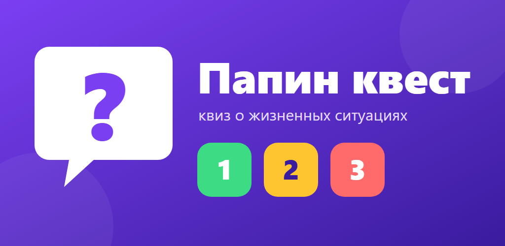
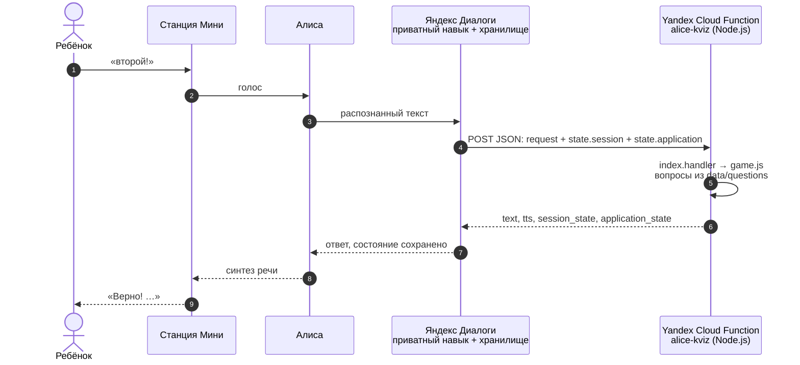
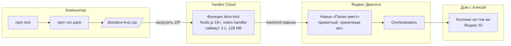
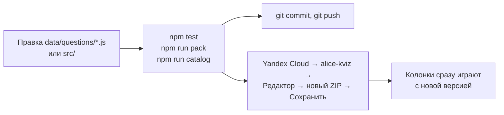

<p align="center">
  
</p>

<h1 align="center">«Папин квест» — квиз для Алисы</h1>

<p align="center">
  
  
  
  
  
  
</p>

> 🇬🇧 **A voice quiz game for Yandex Alice smart speakers that teaches kids aged 6–10 how to behave in
> everyday situations.** Alice describes a situation and reads three answers: the right one, a tricky
> one and a funny "bad advice". The game speaks Russian, so the rest of this README, the docs and all
> the content are in Russian as well. **[Read the English README →](README_en.md)**

---

Голосовая мини-игра для детей 6–10 лет на колонках с Алисой. Алиса рассказывает жизненную ситуацию
(в школе, дома, в гостях, в кафе, в отпуске, в самолёте, в лодке, в зоопарке, на хоре, на уроке
скрипки, с друзьями, в семье…) и читает три ответа: **правильный**, **с подвохом** (слегка вредный
или излишне смелый) и **смешной «вредный совет»**. Порядок ответов каждый раз случайный. В игре
5 или 10 вопросов из банка в 165 вопросов, в конце Алиса называет очки и звание и предлагает сыграть ещё. Есть уровни
«лёгкий» (с 6 лет) и «сложный» (с 9–10 лет). Уровень и число вопросов каждая колонка запоминает и
больше не спрашивает; поменять их можно голосом прямо во время игры.

- Спецификация: [docs/](docs/)
  - [01 — видение и рамки](docs/01-vision.md)
  - [02 — игровой дизайн](docs/02-game-design.md)
  - [03 — сценарий диалога](docs/03-dialog-flow.md)
  - [04 — как писать вопросы](docs/04-content-guide.md)
  - [05 — каталог вопросов](docs/05-content-catalog.md) (генерируется)
  - [06 — техническая спецификация](docs/06-tech-spec.md)
  - [07 — тестирование](docs/07-testing.md)
  - [08 — развитие](docs/08-roadmap.md)
- Вопросы: [data/questions/](data/questions/)
- Код навыка: [src/](src/)

## Как это звучит

> **Ребёнок:** Алиса, запусти навык «Папин квест».
>
> **Алиса:** Начинаем! Уровень лёгкий, пять вопросов. Первый вопрос. На улице.
> Незнакомый человек на улице зовёт посмотреть щенков. Что делать?
> 1 — Попросить сначала показать котят, а потом слонят.
> 2 — Отказаться, отойти и рассказать родителям.
> 3 — Пойти, если это совсем недалеко.
>
> **Ребёнок:** Второй!
>
> **Алиса:** Верно! С незнакомцами никуда не ходят, даже если обещают что-то интересное. Сразу иди
> к своим взрослым. Второй вопрос…

## Как это устроено

```
Станция Мини ─▶ Алиса ─▶ Яндекс Диалоги (ваш приватный навык) ─▶ функция в Yandex Cloud (этот код)
```

Навык **приватный**: он доступен только вашему аккаунту Яндекса, а значит, обеим колонкам на этом
аккаунте. Публичная модерация не нужна. Код работает как бессерверная функция в Yandex Cloud,
сервер держать не надо.

<details>
<summary><b>🗺️ Схема: как навык хостится, настраивается и обновляется</b></summary>

### Хостинг: один ход игры

Сервера и базы нет. Всё состояние (текущая игра, уровень, история вопросов) Алиса хранит сама и
присылает функции в каждом запросе, а функция возвращает обновлённое.



### Настройка: один раз



Подробно по шагам: разделы [1–6](#1-что-понадобится) ниже.

### Обновление: новые вопросы или код



Переопубликовывать навык в Диалогах не нужно: он всегда вызывает последнюю версию функции.
Подробно: раздел [7](#7-как-обновить-вопросы).

</details>

---

## 1. Что понадобится

- Аккаунт Яндекса (Яндекс ID), к которому привязаны обе колонки.
- Компьютер с [Node.js](https://nodejs.org) 18 или новее, чтобы собрать архив и прогнать тесты.
- Банковская карта, чтобы создать платёжный аккаунт в Yandex Cloud. Домашняя нагрузка (сотни
  запросов в день) укладывается в бесплатный уровень Cloud Functions. Актуальные лимиты смотрите на
  странице тарифов Yandex Cloud.

## 2. Проверить колонки и аккаунт

1. Откройте приложение **«Дом с Алисой»** (раньше настройки были в приложении «Яндекс»).
2. Убедитесь, что обе Станции Мини видны в списке устройств **под одним аккаунтом** и подключены к Wi-Fi.
3. Запомните, под каким аккаунтом вы вошли: в Диалоги и Облако нужно входить **под ним же**.
   Приватный навык виден только аккаунту владельца.
4. Для детей полезно, но не обязательно:
   - в настройках колонки выберите режим контента «Семейный» или «Детский»;
   - если в детском режиме навык не запускается, переключите колонку в «Семейный»: некоторые
     ограничения детского режима касаются сторонних навыков;
   - голосовой профиль родителя защитит покупки и настройки от детских команд.

## 3. Собрать архив с кодом

```bash
npm test          # тесты
npm run pack      # проверка вопросов + сборка dist/alice-kviz.zip
```

Внешних зависимостей нет, `npm install` не нужен. Архив содержит `index.js`, `package.json`, `src/`, `data/`.

Можно сначала поиграть в терминале:

```bash
npm run play
```

## 4. Создать функцию в Yandex Cloud

1. Откройте [console.yandex.cloud](https://console.yandex.cloud) под **тем же Яндекс ID**.
2. При первом входе создайте облако и платёжный аккаунт (мастер подскажет). Каталог `default` подойдёт.
3. В каталоге выберите сервис **Cloud Functions** → **Создать функцию**.
   - Имя: `alice-kviz`.
4. Откройте функцию → **Редактор** → создайте версию:
   - Среда выполнения: **Node.js** (самая новая из предложенных, но не ниже 18).
   - Способ: **ZIP-архив** → загрузите `dist/alice-kviz.zip`.
   - Точка входа: `index.handler`.
   - Таймаут: `3` секунды, память: `128 МБ`.
   - Переменные окружения: не нужны. `SOUNDS=1` включает звуки, но сначала проверьте их в
     [06-tech-spec.md](docs/06-tech-spec.md#переменные-окружения-функции).
   - **Сохранить изменения.**
5. Делать функцию публичной **не нужно**: Диалоги вызывают её напрямую.
6. Проверка: вкладка **Тестирование** функции, шаблон «Навык Алисы» (или вставьте JSON ниже) →
   **Запустить тест**. В ответе должен быть `"text": "Привет! Это игра «Папин квест»…"`.

   ```json
   { "version": "1.0", "session": { "new": true }, "request": { "command": "", "original_utterance": "" }, "state": {} }
   ```

## 5. Создать навык в Яндекс Диалогах

1. Откройте [dialogs.yandex.ru/developer](https://dialogs.yandex.ru/developer) под **тем же Яндекс ID**.
2. **Создать диалог** → **Навык в Алисе**.
3. Вкладка **Настройки**:
   | Поле | Что указать |
   |---|---|
   | Название | `Папин квест` |
   | Активационное имя | `папин квест`. Если имя не принимают, возьмите другое и поменяйте `SKILL_NAME` в [src/phrases.js](src/phrases.js) |
   | Примеры запросов | `запусти навык папин квест`, `попроси папин квест сложный уровень` |
   | Backend | **Функция в Яндекс Облаке** → выберите `alice-kviz` |
   | Тип доступа | **Приватный** |
   | Хранилище | **включить** («Использовать хранилище данных в навыке»), чтобы колонка помнила уровень и число вопросов и не повторяла вопросы |
   | Голос | Алиса (по умолчанию) |
   | Где доступен | оставьте умные колонки (и другие устройства по желанию) |
   | Описание, категория, иконка | любые: заполните обязательные поля формы (например, категория «Игры и развлечения», иконка 1024×500 [`assets/icon-1024x500.png`](assets/icon-1024x500.png)) |
4. **Сохранить**.
5. Вкладка **Тестирование**: поиграйте в чате прямо в консоли. Подсказки-кнопки `1 / 2 / 3`
   ускоряют проверку.
6. **Опубликовать** (кнопка «На модерацию» / «Опубликовать»). Приватные навыки не проходят полную
   публичную модерацию, обычно публикация занимает от нескольких минут до часа. Статус виден в консоли.

## 6. Играть на колонках

Скажите любой колонке на этом аккаунте:

- **«Алиса, запусти навык „Папин квест“»** — в первый раз приветствие и выбор уровня, дальше игра
  начинается сразу с прошлым уровнем и числом вопросов.
- **«Алиса, попроси „Папин квест“ сложный уровень, десять вопросов»** — игра начнётся сразу с этими настройками.

Во время игры:

| Сказать | Что будет |
|---|---|
| «один» / «два» / «три», «первый», «давай второй», «третий вариант» | ответ |
| пересказ ответа или его части: «уступить место» | тоже ответ |
| «сложный уровень» / «лёгкий уровень», «посложнее» / «полегче» | сменить уровень сразу, оставшиеся вопросы заменятся; колонка запомнит |
| «десять вопросов» / «пять вопросов» | сделать игру длиннее или короче; колонка запомнит |
| «повтори» | повторить вопрос |
| «не знаю» | Алиса скажет правильный ответ |
| «помощь» | правила |
| «хватит» / «Алиса, хватит» | выход |

У каждой колонки свой уровень, своё число вопросов и своя история вопросов: сын играет на своей колонке на «сложном»,
дочь на своей на «лёгком», и игры друг другу не мешают.

## 7. Как обновить вопросы

1. Отредактируйте или добавьте вопросы в `data/questions/*.js` по правилам из [04-content-guide.md](docs/04-content-guide.md).
2. `npm test && npm run pack && npm run catalog`
3. Yandex Cloud → функция `alice-kviz` → **Редактор** → загрузите новый `dist/alice-kviz.zip` → **Сохранить**.
   Навык подхватит новую версию сразу, переопубликовывать его в Диалогах не нужно.

## Если что-то не работает

| Симптом | Что проверить |
|---|---|
| «Такого навыка нет» / Алиса ищет в интернете | навык опубликован? Приватный навык тоже надо отправить на модерацию: без этого он работает только во вкладке «Тестирование». Колонки на том же аккаунте, что и консоль Диалогов? произносите активационное имя точно, через «запусти навык» |
| Кнопка «Отправить на модерацию» неактивна | наведите на неё мышь, чтобы увидеть причину; заполните поля, подсвеченные красным (иконка, описание, категория, backend), нажмите «Сохранить» и обновите страницу |
| «Навык не отвечает» | Cloud Functions → `alice-kviz` → **Логи**: ошибка в коде или таймаут; точка входа `index.handler`; в архиве `index.js` лежит в корне |
| Не запоминаются уровень и число вопросов, вопросы повторяются | включите «Хранилище» в настройках навыка |
| Не запускается на детской колонке | попробуйте режим «Семейный» вместо «Детский» в «Дом с Алисой» |
| Алиса не понимает ответ | отвечайте номером: «один», «два», «три»; добавьте синонимы в `src/matcher.js` |
| Нет звуков | они выключены по умолчанию; `SOUNDS=1` в переменных окружения функции |

## Разработка

```bash
npm test            # автотесты (node:test)
npm run validate    # проверка банка вопросов
npm run play        # игра в терминале (-- --tts, -- --seed 42)
npm run catalog     # пересобрать docs/05-content-catalog.md
npm run pack        # dist/alice-kviz.zip для Yandex Cloud
```

Правила для участников и ИИ-агентов, в том числе про языки репозитория: [AGENTS.md](AGENTS.md).
