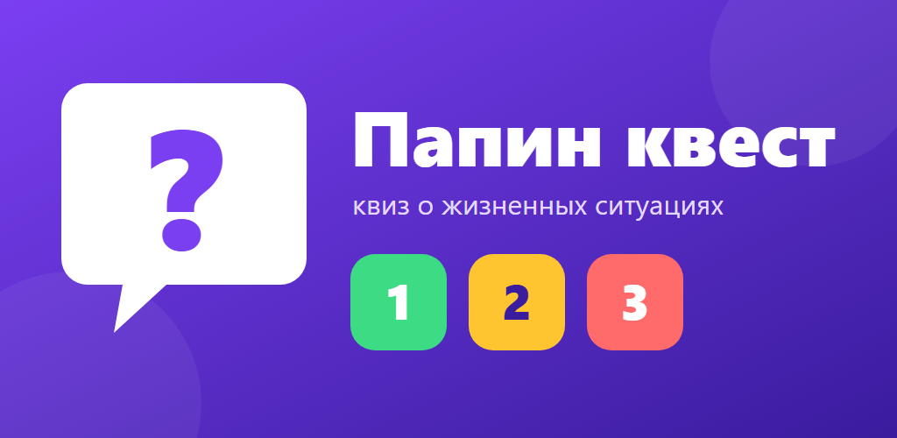
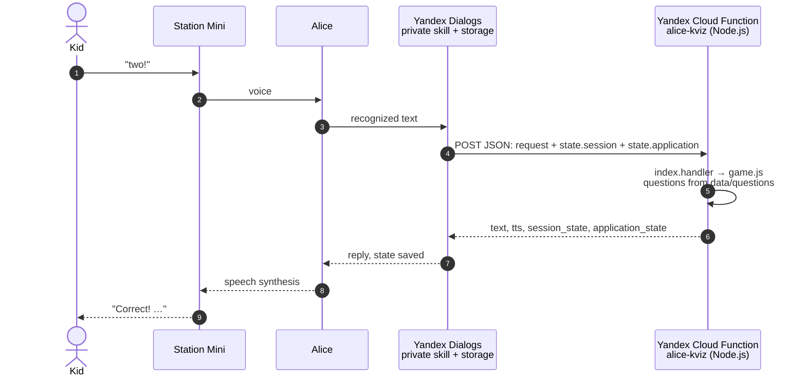
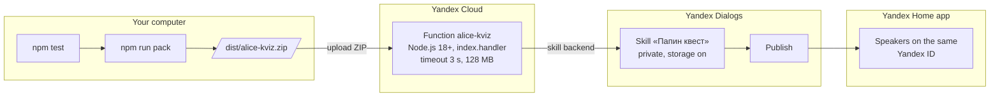
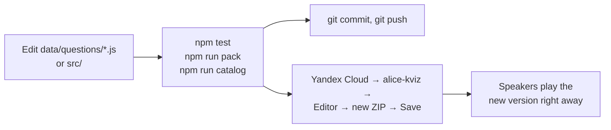

<p align="center">
  
</p>

<h1 align="center">Papin kvest (Dad's Quest) — a quiz for Yandex Alice</h1>

<p align="center">
  
  
  
  
  
  
</p>

> 🇷🇺 This is the English version. The main README is in Russian: **[README.md](README.md)**.
> The game itself, the docs in [docs/](docs/) and all questions are in Russian, because the game runs
> on Russian-speaking Yandex Alice speakers.

---

**Papin kvest** («Папин квест», "Dad's Quest") is a voice mini-game for kids aged 6–10 on Yandex
smart speakers with Alice. Alice tells an everyday situation (at school, at home, visiting friends,
in a café, on holiday, on a plane, in a boat, at the zoo, at choir, at a violin lesson, with
friends, in the family…) and reads three answers: the **right** one, a **tricky** one (slightly
selfish or too bold) and a **funny "bad advice"**. The order of the answers is shuffled every time.
A game has 5 or 10 questions out of a bank of 165; at the end Alice announces the score and a title
and offers another round. There are two levels: "easy" (from age 6) and "hard" (from age 9–10).
Each speaker remembers its level and the number of questions and doesn't ask again; both can be
changed by voice in the middle of a game.

- Specification (Russian): [docs/](docs/)
  - [01 — vision and scope](docs/01-vision.md)
  - [02 — game design](docs/02-game-design.md)
  - [03 — dialog flow](docs/03-dialog-flow.md)
  - [04 — how to write questions](docs/04-content-guide.md)
  - [05 — question catalog](docs/05-content-catalog.md) (generated)
  - [06 — technical spec](docs/06-tech-spec.md)
  - [07 — testing](docs/07-testing.md)
  - [08 — roadmap](docs/08-roadmap.md)
- Questions: [data/questions/](data/questions/)
- Skill code: [src/](src/)

## What it sounds like

Translated from Russian:

> **Kid:** Alice, launch the skill "Papin kvest".
>
> **Alice:** Let's start! Easy level, five questions. First question. On the street.
> A stranger on the street invites you to come and see some puppies. What do you do?
> 1 — Ask to be shown kittens first, and then baby elephants.
> 2 — Say no, step away and tell your parents.
> 3 — Go, if it's really close by.
>
> **Kid:** Two!
>
> **Alice:** Correct! You never go anywhere with strangers, even if they promise something
> interesting. Go straight to your grown-ups. Second question…

## How it works

```
Station Mini ─▶ Alice ─▶ Yandex Dialogs (your private skill) ─▶ Yandex Cloud Function (this code)
```

The skill is **private**: only your Yandex account can use it, which means every speaker on that
account. No public moderation is needed. The code runs as a serverless function in Yandex Cloud, so
there is no server to keep running.

<details>
<summary><b>🗺️ Diagram: how the skill is hosted, set up and updated</b></summary>

### Hosting: one game turn

There is no server and no database. Alice keeps all the state (current game, level, question
history) and sends it to the function with every request; the function returns the updated state.



### Setup: once



Step by step: sections [1–6](#1-what-you-need) below.

### Updating: new questions or code



No need to republish the skill in Dialogs: it always calls the latest function version.
Details: section [7](#7-updating-the-questions).

</details>

---

## 1. What you need

- A Yandex account (Yandex ID) that your speakers are linked to.
- A computer with [Node.js](https://nodejs.org) 18 or newer to build the archive and run the tests.
- A bank card to create a billing account in Yandex Cloud. A household load (hundreds of requests a
  day) fits into the Cloud Functions free tier. Check the current limits on the Yandex Cloud pricing
  page.

## 2. Check the speakers and the account

1. Open the **Yandex Home app** («Дом с Алисой»; the settings used to be in the "Yandex" app).
2. Make sure your speakers are listed **under the same account** and connected to Wi-Fi.
3. Note which account you are signed in with: you must sign in to Dialogs and Cloud **with the same
   one**. A private skill is visible only to its owner's account.
4. Useful for kids, but optional:
   - choose the "Family" («Семейный») or "Kids" («Детский») content mode in the speaker settings;
   - if the skill doesn't start in Kids mode, switch the speaker to Family: some Kids mode
     restrictions apply to third-party skills;
   - a parent's voice profile protects purchases and settings from kids' commands.

## 3. Build the code archive

```bash
npm test          # tests
npm run pack      # validate the questions + build dist/alice-kviz.zip
```

There are no external dependencies, so `npm install` is not needed. The archive contains `index.js`,
`package.json`, `src/`, `data/`.

You can play in the terminal first (in Russian):

```bash
npm run play
```

## 4. Create a function in Yandex Cloud

1. Open [console.yandex.cloud](https://console.yandex.cloud) with **the same Yandex ID**.
2. On first visit, create a cloud and a billing account (the wizard guides you). The `default`
   folder is fine.
3. In the folder, choose **Cloud Functions** → **Create function**.
   - Name: `alice-kviz`.
4. Open the function → **Editor** → create a version:
   - Runtime: **Node.js** (the newest offered, but at least 18).
   - Method: **ZIP archive** → upload `dist/alice-kviz.zip`.
   - Entry point: `index.handler`.
   - Timeout: `3` seconds, memory: `128 MB`.
   - Environment variables: none needed. `SOUNDS=1` turns on sounds, but check them first, see
     [06-tech-spec.md](docs/06-tech-spec.md#переменные-окружения-функции).
   - **Save changes.**
5. The function does **not** need to be public: Dialogs calls it directly.
6. Check: the function's **Testing** tab, template "Alice skill" (or paste the JSON below) →
   **Run test**. The response must contain `"text": "Привет! Это игра «Папин квест»…"`.

   ```json
   { "version": "1.0", "session": { "new": true }, "request": { "command": "", "original_utterance": "" }, "state": {} }
   ```

## 5. Create the skill in Yandex Dialogs

The Dialogs console is in Russian; the Russian labels are given in brackets.

1. Open [dialogs.yandex.ru/developer](https://dialogs.yandex.ru/developer) with **the same Yandex ID**.
2. **Create dialog** («Создать диалог») → **Alice skill** («Навык в Алисе»).
3. **Settings** tab («Настройки»):
   | Field | Value |
   |---|---|
   | Name («Название») | `Папин квест` |
   | Activation name («Активационное имя») | `папин квест`. If it's rejected, pick another one and change `SKILL_NAME` in [src/phrases.js](src/phrases.js) |
   | Example requests («Примеры запросов») | `запусти навык папин квест`, `попроси папин квест сложный уровень` |
   | Backend | **Yandex Cloud function** («Функция в Яндекс Облаке») → choose `alice-kviz` |
   | Access type («Тип доступа») | **Private** («Приватный») |
   | Storage («Хранилище») | **on** («Использовать хранилище данных в навыке»), so a speaker remembers the level and the number of questions and doesn't repeat questions |
   | Voice («Голос») | Alice (default) |
   | Surfaces («Где доступен») | keep smart speakers (and other devices if you like) |
   | Description, category, icon | anything: fill in the required form fields (e.g. category "Games and entertainment", 1024×500 icon [`assets/icon-1024x500.png`](assets/icon-1024x500.png)) |
4. **Save** («Сохранить»).
5. **Testing** tab («Тестирование»): play in the chat right in the console. The `1 / 2 / 3` hint
   buttons speed up testing.
6. **Publish** («На модерацию» / «Опубликовать»). Private skills skip full public moderation;
   publishing usually takes from a few minutes to an hour. The status is shown in the console.

## 6. Play on the speakers

Say to any speaker on this account (the skill only understands Russian):

- **«Алиса, запусти навык „Папин квест“»** ("Alice, launch the skill Papin kvest") — the first time
  you get a greeting and a level choice; after that the game starts right away with the last level
  and number of questions.
- **«Алиса, попроси „Папин квест“ сложный уровень, десять вопросов»** ("…hard level, ten
  questions") — the game starts right away with these settings.

During the game:

| Say | What happens |
|---|---|
| «один» / «два» / «три», «первый», «давай второй», «третий вариант» (one / two / three, first, second…) | answer |
| retelling the answer or part of it: «уступить место» | also an answer |
| «сложный уровень» / «лёгкий уровень», «посложнее» / «полегче» (hard / easy level) | switch the level right away, the remaining questions are replaced; the speaker remembers |
| «десять вопросов» / «пять вопросов» (ten / five questions) | make the game longer or shorter; the speaker remembers |
| «повтори» (repeat) | repeat the question |
| «не знаю» (I don't know) | Alice tells the right answer |
| «помощь» (help) | rules |
| «хватит» / «Алиса, хватит» (stop) | exit |

Each speaker has its own level, number of questions and question history: one kid plays on their
speaker at "hard", another on theirs at "easy", and the games don't interfere.

## 7. Updating the questions

1. Edit or add questions in `data/questions/*.js` following the rules in
   [04-content-guide.md](docs/04-content-guide.md) (Russian).
2. `npm test && npm run pack && npm run catalog`
3. Yandex Cloud → function `alice-kviz` → **Editor** → upload the new `dist/alice-kviz.zip` → **Save**.
   The skill picks up the new version immediately, no need to republish it in Dialogs.

## Troubleshooting

| Symptom | What to check |
|---|---|
| "No such skill" / Alice searches the web | Is the skill published? A private skill must also be sent to moderation, otherwise it works only in the Testing tab. Are the speakers on the same account as the Dialogs console? Say the activation name exactly, via «запусти навык» |
| The "Send to moderation" button is disabled | Hover over it to see the reason; fill in the fields highlighted in red (icon, description, category, backend), click Save and reload the page |
| "The skill is not responding" | Cloud Functions → `alice-kviz` → **Logs**: a code error or a timeout; entry point `index.handler`; `index.js` must be at the root of the archive |
| Level and number of questions aren't remembered, questions repeat | Turn on Storage in the skill settings |
| Doesn't start on a kids' speaker | Try Family mode instead of Kids in the Yandex Home app |
| Alice doesn't understand the answer | Answer with a number: «один», «два», «три»; add synonyms in `src/matcher.js` |
| No sounds | They are off by default; set `SOUNDS=1` in the function's environment variables |

## Development

```bash
npm test            # automated tests (node:test)
npm run validate    # check the question bank
npm run play        # play in the terminal (-- --tts, -- --seed 42)
npm run catalog     # rebuild docs/05-content-catalog.md
npm run pack        # dist/alice-kviz.zip for Yandex Cloud
```

Contributor and agent rules, including the language policy: [AGENTS.md](AGENTS.md).
