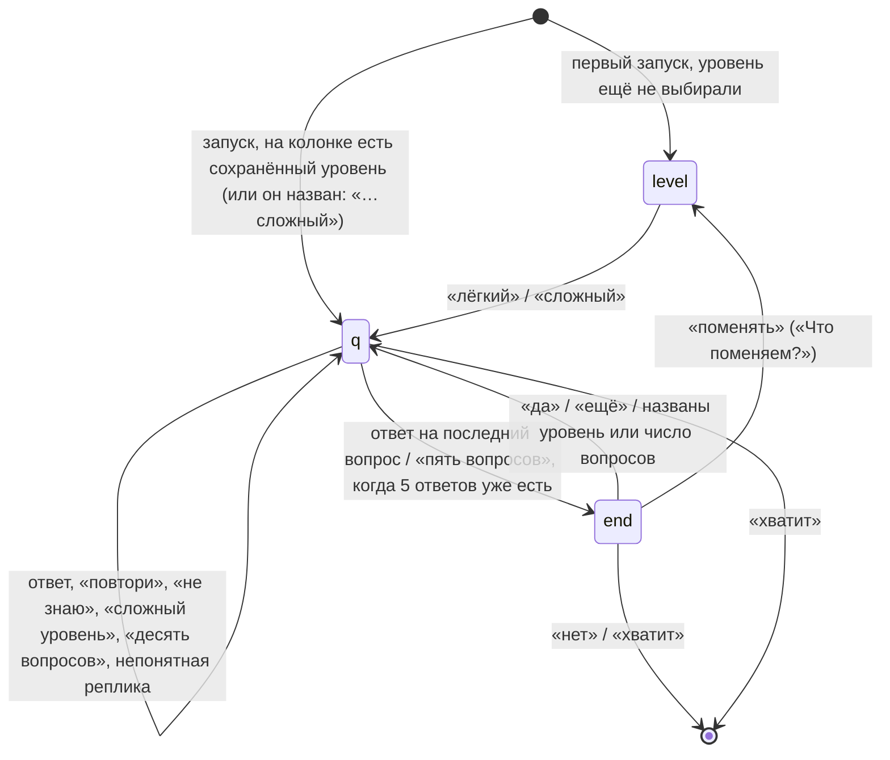

# 03. Сценарий диалога

## Состояния

Состояние хранится в `session_state.st`.



| Состояние | Что ждём | Что говорит Алиса при непонятной реплике |
|---|---|---|
| `level` | уровень (и/или число вопросов) | «Скажи „лёгкий“ или „сложный“.» |
| `q` | номер или пересказ ответа | «Не расслышала. Скажи номер ответа: один, два или три.» + вопрос заново |
| `end` | «да» / «нет» / уровень / число вопросов | «Сыграем ещё? Скажи „да“ или „хватит“.» |

Шага «В прошлый раз был лёгкий уровень. Играем так же?» больше нет: настройки не спрашиваются
перед каждой игрой. Сессия со старым `st: "confirm"` после обновления навыка просто начинает игру
с сохранёнными настройками.

## Реплики, которые понимает навык

| Что сказать | Где работает | Что произойдёт |
|---|---|---|
| «один», «первый», «1», «вариант два», «давай второй», «номер три», «наверное третий» | `q` | ответ на вопрос |
| пересказ ответа или его части («уступить место», «спасательный жилет», «колыбельную») | `q` | ответ: выбирается вариант с наибольшим совпадением слов |
| «повтори», «ещё раз», «что?» | `q` | повторить текущий вопрос с вариантами |
| «не знаю», «сдаюсь», «пропусти», «дальше» | `q` | Алиса называет правильный ответ, очко не начисляется |
| «помощь», «правила», «как играть» | везде | правила и возврат к текущему шагу |
| «лёгкий», «для малышей», «мне 6 лет» / «сложный», «для школьников», «мне 10» | `level`, `end`, запуск | выбрать уровень, запомнить и начать |
| «сложный уровень», «посложнее», «лёгкий уровень», «полегче» | `q` | сменить уровень сразу: текущий и оставшиеся вопросы заменяются, очки сохраняются |
| «десять вопросов», «10 задач», «подлиннее» / «пять вопросов», «покороче» | везде | сменить и запомнить число вопросов (в `q` — в текущей игре, в `end` — новая игра) |
| «пять» / «десять» без слова «вопросов» | `level` после «поменять» | число вопросов (в первом выборе уровня «десять» — это возраст, то есть «сложный») |
| «да», «давай», «ещё», «играем» | `end` | новая игра с теми же настройками |
| «поменять», «другой уровень» | `q` → подсказка; `end` → «Что поменяем?» | |
| «нет» | `end` → выход | |
| «хватит», «стоп», «надоело», «не хочу играть» | везде | выход (если игра шла — со счётом) |
| «Алиса, хватит» | везде | выход силами самой Алисы, навык не вызывается |

## Порядок разбора реплики в вопросе

Реплика в состоянии `q` разбирается по шагам, первый подходящий шаг побеждает:

1. Реплика целиком — команда («повтори», «не знаю», «хватит») → выполнить команду.
2. Реплика целиком про настройки («сложный уровень», «давай полегче», «десять вопросов») → сменить
   настройки. Здесь узнаются только точные формы слов, поэтому «сложить вещи» или «это сложно» —
   не настройки. Одно голое слово («сложный») считается настройкой, только если оно не подходит
   как пересказ ответа.
3. Распознан ответ (номер или пересказ) → засчитать ответ. Поэтому вариант «Подождать следующий
   лифт» засчитается как ответ, хотя в нём есть слово «следующий».
4. Короткая реплика (до 4 слов) содержит командное слово → выполнить команду.
5. Иначе: «Не расслышала…» и повтор вопроса.

Встроенные интенты Алисы (`YANDEX.REPEAT`, `YANDEX.HELP`, `YANDEX.CONFIRM`, `YANDEX.REJECT`) учитываются
наравне со словами.

## Запуск

- «Алиса, запусти навык „Папин квест“»:
  - в первый раз — приветствие, правила и выбор уровня;
  - дальше — короткое приветствие и сразу первый вопрос с сохранёнными уровнем и числом вопросов.
    Первые 3 запуска звучит подсказка «Чтобы поменять, скажи „сложный уровень“ или „десять вопросов“».
- «Алиса, попроси „Папин квест“ сложный уровень, десять вопросов» — настройки берутся из фразы
  запуска и запоминаются, игра начинается сразу.

## Выход и обрыв сессии

- По «хватит» навык отвечает `end_session: true` и называет счёт, если игра шла.
- Если ребёнок замолчал, колонка закрывает навык сама. Незаконченная игра не сохраняется
  (`session_state` живёт только в сессии), а уровень, число вопросов и история остаются.

## Формат одного вопроса

Текст (для экрана и логов):

```
Третий вопрос. В лодке.
Вы садитесь кататься на лодке. Что нужно надеть первым делом?
1. Ласты на руки.
2. Спасательный жилет.
3. Красивую кепку, чтобы на фото было здорово.
```

Голос (`tts`):

```
Третий вопрос. В лодке. sil <[300]> Вы садитесь кататься на лодке. Что нужно надеть первым делом?
sil <[500]> Один: Ласты на руки. sil <[400]> Два: Спасательный жилет. sil <[400]> Три: Красивую кепку…
```

Последний вопрос (пятый или десятый) начинается словами «Последний вопрос!».

## Конец игры

После ответа на последний вопрос в той же реплике звучат: реакция и объяснение, очки
(«Игра окончена! У тебя 4 очка из 5.»), звание, число выбранных вредных советов (если были; смешные версии в загадках `kind: 'guess'` не в счёт)
и предложение «Сыграем ещё? Скажи „да“ или „хватит“.» Состояние становится `end`:
«да» начинает новую игру с теми же настройками, «сложный уровень» / «десять вопросов» — новую игру
с новыми настройками, «поменять» — «Что поменяем?», «хватит» — выход.
Если ребёнок говорит «хватит» посреди игры, Алиса тоже называет очки: «У тебя 2 очка из 3.»
